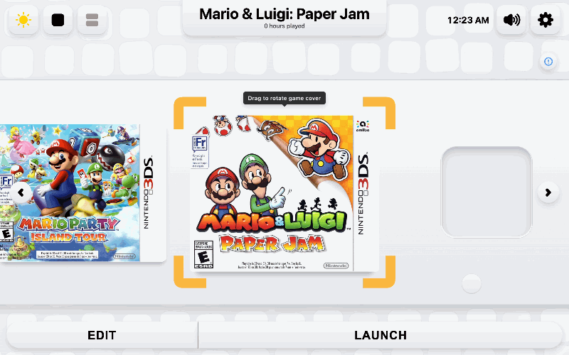
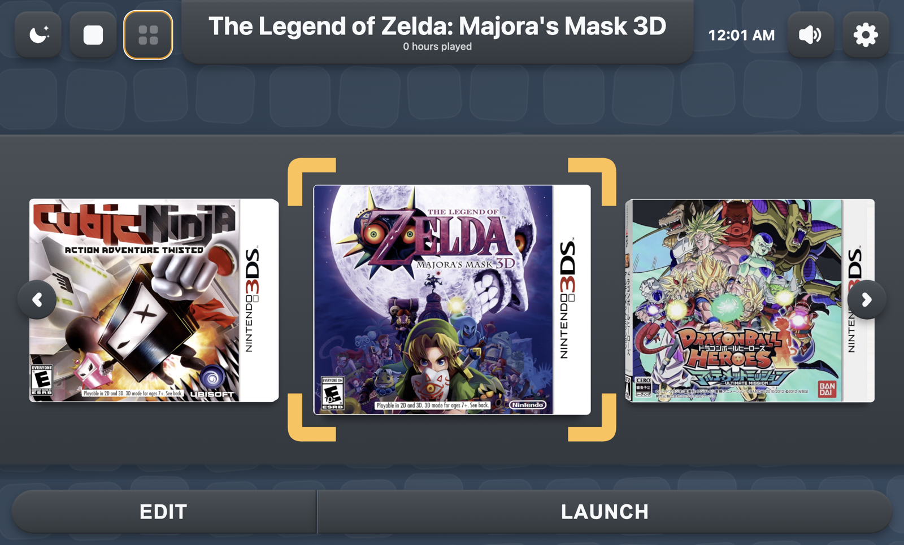
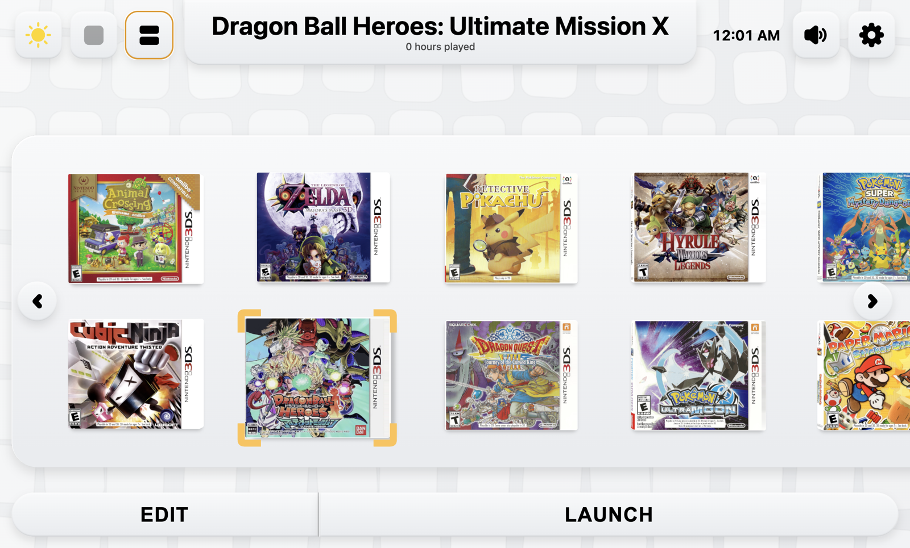
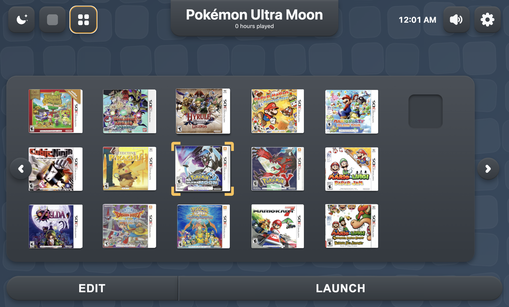
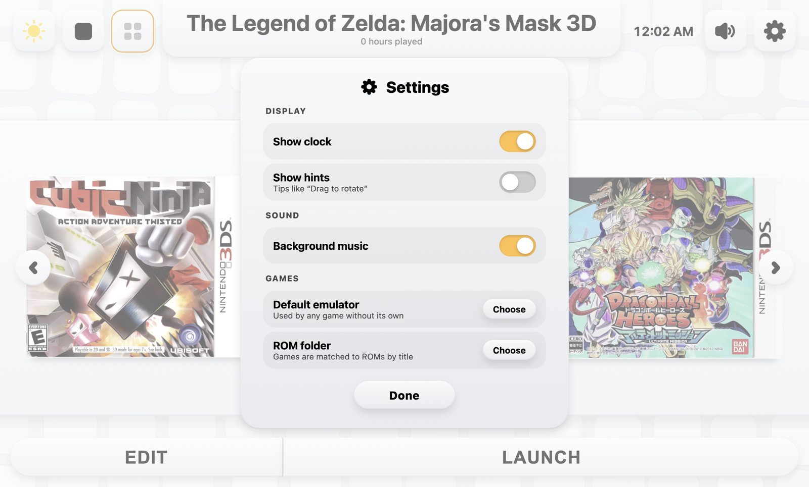
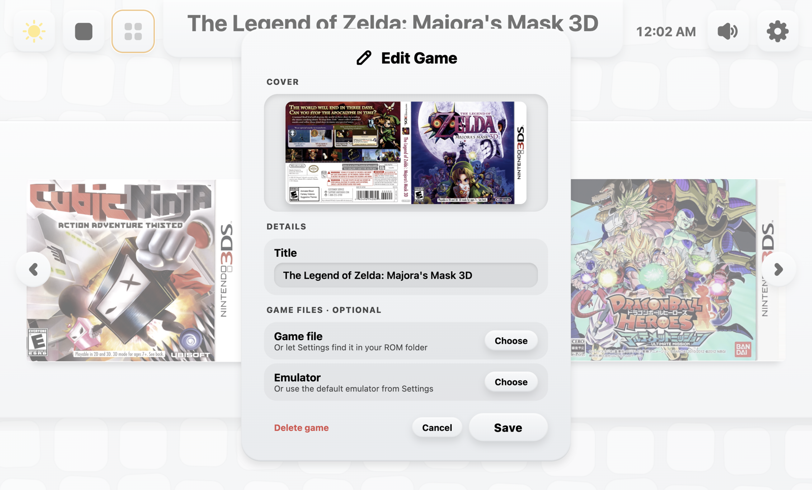

# Game Stash

A desktop shelf for your Nintendo 3DS collection, styled after the 3DS and Switch home menus. Every game sits on the shelf as a 3D game case you can browse, spin and launch.

Built with React, TypeScript, Three.js and Electron. Runs on macOS and Windows.

<div align="center">



</div>

> Emulators and ROMs are not included. Game Stash only organizes and launches files you already have. A shelf of just covers is fine too.

## Features

- **3D game cases.** Each cover scan is wrapped around a rounded case, with the back, spine and front on the right faces. Click a game to select it, drag to spin it.
- **Three layouts.** One big row, two rows, or a compact 2×2 grid. The games morph between layouts, and the panel they sit on stretches with them.
- **Console-style browsing.** Arrow keys or the on-screen arrows move the selector. The selected game is kept in the middle of the screen until you reach either end of the shelf, where the selector walks to the edge instead. The selected game lifts toward you.
- **Add games with just a cover.** A title and a cover scan are all a game needs. Add a game file and an emulator whenever you want to launch it.
- **Settings.** Pick a default emulator (a Windows `.exe` or a macOS `.app`) and a ROM folder. Games without their own paths use these, and ROMs are matched to games by title, so "Pokémon Y" finds `Pokemon Y (USA).3ds`. You can also toggle the clock, hints and background music.
- **Light and dark themes**, a TV-style volume control, and one soft click sound, pitched up and down, for every button.
- **Everything stays local.** Games, covers and settings live on your computer. No account, no internet needed.

| Dark theme | Two rows |
|---|---|
|  |  |

| Compact grid | Settings |
|---|---|
|  |  |



## Download

Get the latest build from the [Releases page](https://github.com/tayyab3245/game-stash/releases/latest).

- **macOS (Apple Silicon):** `Game Stash-1.1.0-arm64.dmg`. The app isn't signed with an Apple developer certificate, so the first time, right-click it and choose **Open**.
- **Windows:** build it from source (below).

## Run it locally

```bash
git clone https://github.com/tayyab3245/game-stash.git
cd game-stash
npm install
npm run dev
```

`npm run dev` starts the React dev server and opens the Electron window. Set `GAME_STASH_DEVTOOLS=1` to also open DevTools.

<details>
<summary>macOS setup notes</summary>

The repo's `.npmrc` is set up for Windows builds. On a Mac, install with the platform overridden, then make sure Electron and the SQLite module are in place:

```bash
npm_config_target_platform=darwin npm_config_target_arch=arm64 npm install
node node_modules/electron/install.js
npx electron-rebuild -f -w sqlite3
```

Recent npm versions skip install scripts unless they're approved, which is why the last two commands are needed.

</details>

### Build

```bash
npm run electron-pack-mac   # macOS .dmg
npm run electron-pack-win   # Windows installer + portable .exe (build on Windows)
```

## How it works

**Rendering (Three.js).** Each case is a `RoundedBoxGeometry` from the Three.js examples. The cover is a single scan of the whole case, so its texture is split into back, spine and front by UV offsets. These are hand-tuned to the standard 3DS scan size (3236 × 1360) so the art lines up on the right faces. Clicks become selections through Three's `Raycaster`.

**The shelf.** The covers and the panel they sit on live in one group that slides past a still camera, which is what keeps them perfectly in sync. The panel's rounded shape, gradient and shadow are painted into a canvas texture sized to the panel, and drawn in its own pass underneath the covers. Each cover casts a soft shadow onto the panel, and the camera zooms so the panel fills the view in every layout.

**Smoothness.** Cover scans can be 6000+ pixels wide. They're decoded off the main thread with `createImageBitmap`, downscaled to 2560px, and uploaded to the GPU as soon as they load, so scrolling never stalls on a new cover. Animations are frame-rate independent and run outside React, so React only re-renders when something actually changes.

**Desktop layer (Electron).**
- **Data:** games are stored in a local SQLite database, and settings in a JSON file, both in the app's user-data folder.
- **Covers:** copied there too, and served to the renderer by a small local HTTP server.
- **Launching:** the game is spawned with its emulator, or opened through macOS's `open` for `.app` bundles.

**Sound.** Howler.js plays one short click sample at different playback rates. Pressing and releasing a button each click, and the background music starts on your first interaction.

## Project layout

```
src/
  Main.tsx                 app frame: top bar, shelf, command bar, dialogs
  core/gameShelf/          the 3D shelf (layout, camera, panel, covers, controls)
  core/audio/              sounds and music
  core/theme/              light/dark styles and CSS tokens
  features/                top-bar buttons, header, command bar, cursor, settings
  components/              add/edit game dialog, help button, shared dialog styles
  electron/                main process, SQLite database, settings, preload bridge
```

## License

[Apache License 2.0](LICENSE). Free to use, modify and share.
